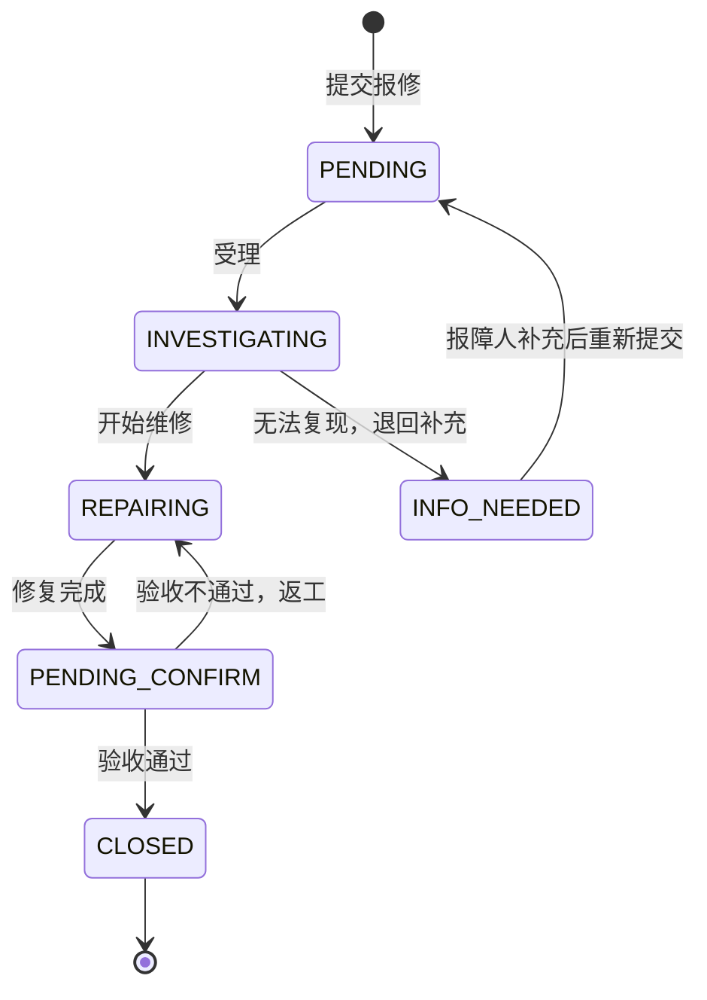

# 需求说明

项目：T05 校园网络与机房故障报修平台
课程：JavaWeb 后端开发技术 / MVVM 前端框架开发技术 / Docker 云容器与管理技术（共用项目）
组号：JavaWeb G20，Docker G18

## 1. 项目目标

把校园网络与机房故障的报修、受理、排查、维修、验收过程记录成可查询、可追责、可统计的数据，替代微信群和电话报修。

## 2. 角色与权限

| 角色 | 说明 | 主要权限 |
| --- | --- | --- |
| 报障人 REPORTER | 学生、教职工 | 提交报修、查看自己的单据、补充信息、验收 |
| 网络技术员 TECHNICIAN | 网络中心值班人员 | 查看全部单据、受理、排查、维修、完成 |
| 管理员 ADMIN | 网络中心负责人 | 技术员权限 + 设备管理 + 用户管理 + 统计 |

| 功能 | 报障人 | 技术员 | 管理员 |
| --- | --- | --- | --- |
| 提交报修 | 是 | 否 | 否 |
| 查看单据 | 仅本人 | 全部 | 全部 |
| 受理 / 维修 / 完成 | 否 | 是 | 是 |
| 退回补充 | 否 | 是 | 是 |
| 补充信息 / 验收 | 本人 | 否 | 否 |
| 设备增删改 | 否 | 只读 | 是 |
| 用户管理 | 否 | 否 | 是 |
| 统计报表 | 否 | 是 | 是 |

## 3. 状态流转



- 非法流转（跳步、重复受理、关闭后再操作）返回 HTTP 400 + `code=1001`
- 每次流转写入 `status_log`，技术员动作写入 `repair_handle`，验收写入 `confirm_record`

## 4. 后端功能需求

### 4.1 认证

- 报障人自助注册，密码 BCrypt 入库
- 登录签发 JWT，拦截器校验 Token，白名单放行登录、注册、健康检查、接口文档
- 当前用户信息、修改密码

### 4.2 设备管理

- 分页查询：关键字、机房、状态
- 机房列表、设备详情
- 新增、修改、删除（仅管理员；存在报修记录时禁止删除）
- 修改设备状态

### 4.3 报修单

- 提交（同人同设备未关闭时拒绝重复提交）
- 分页查询（状态、优先级、关键字、机房、只看我的）
- 详情（状态轨迹、处理记录、验收记录、当前用户可执行动作）
- 状态流转：受理、开始维修、完成、退回补充、补充信息、验收
- 越权防护：报障人只能看和操作自己的单据

### 4.4 用户与统计

- 管理员分页查询用户、启用/禁用账号
- 技术员列表（派单选择）
- 统计概览：总量、未关闭、已关闭、平均修复时长、按机房/状态分组
- 近 N 天新增与关闭趋势

## 5. 前端页面（MVVM 课程）

| 页面 | 路由 | 说明 |
| --- | --- | --- |
| 登录 | `/login` | 用户名密码登录，三种角色 |
| 工作台 | `/dashboard` | 统计卡片与最近工单 |
| 报修单列表 | `/orders` | 分页、状态/优先级/机房筛选 |
| 报修单详情 | `/orders/:id` | 轨迹、处理记录、验收记录、操作按钮 |
| 新建报修 | `/orders/create` | 选择设备、填写故障描述 |
| 设备管理 | `/devices` | 管理员可增删改 |
| 用户管理 | `/users` | 管理员启用/禁用 |
| 统计报表 | `/stats` | 概览、按机房分布、趋势 |
| 个人中心 | `/profile` | 查看资料、修改密码 |
| 404 | `/:pathMatch(.*)*` | 未匹配路由 |

角色菜单：报障人只看报修相关；技术员加工单处理与统计；管理员再增加设备、用户管理。

## 6. 数据模型

7 张表：`sys_role`、`sys_user`、`device`、`repair_order`、`repair_handle`、`status_log`、`confirm_record`。
详细字段、索引与外键见 `database-design.md`，建库脚本见 `database/schema.sql`。

## 7. 非功能需求

- 统一返回 `Result`，错误码规范，真实 HTTP 状态码
- 参数校验使用 `@Valid`，全局异常区分业务异常与系统异常
- 关键操作写日志，不打印密码和 Token
- 数据库地址、账号、密码、JWT 密钥通过环境变量注入
- 健康检查 `/api/health`
- `mvn package` 成功，`java -jar` 可运行

## 8. 提交物

```text
backend/       后端源码、pom.xml、Dockerfile
frontend/      前端源码、package.json、Dockerfile、nginx.conf
database/      schema.sql、seed.sql
docs/          requirements、database-design、api-doc、api-test、business-flow-record、contribution-table、ai-usage-statement
compose.yaml   三服务编排
k8s/           Kubernetes 资源
evidence/      镜像、Compose、K8s、日志、发布回滚、HPA、故障工单
README.md
```
